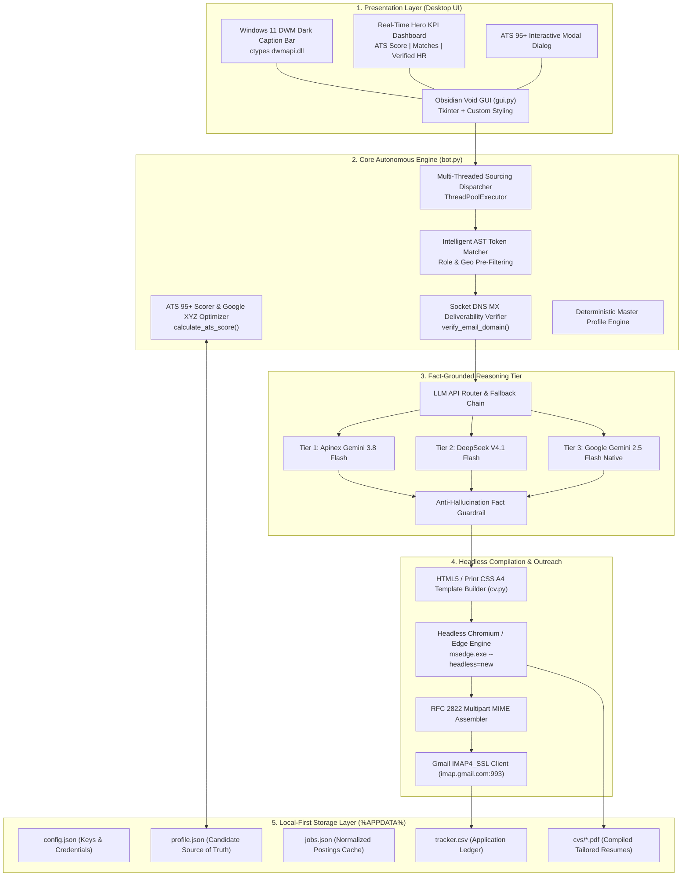
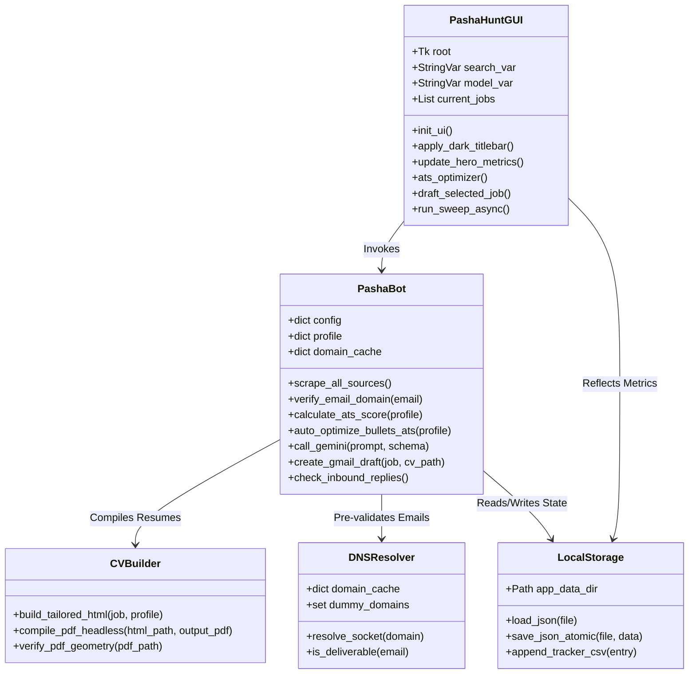
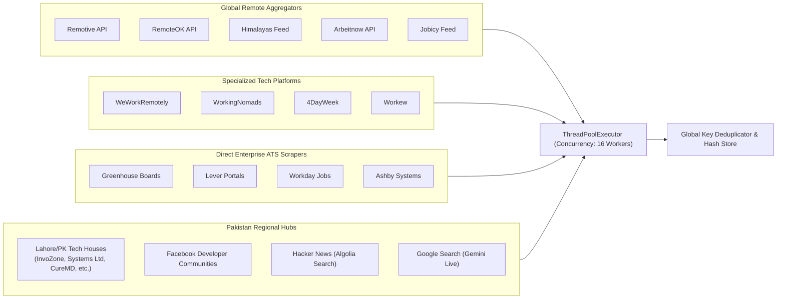
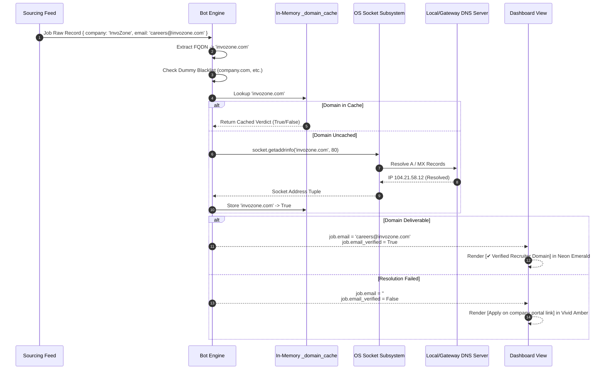
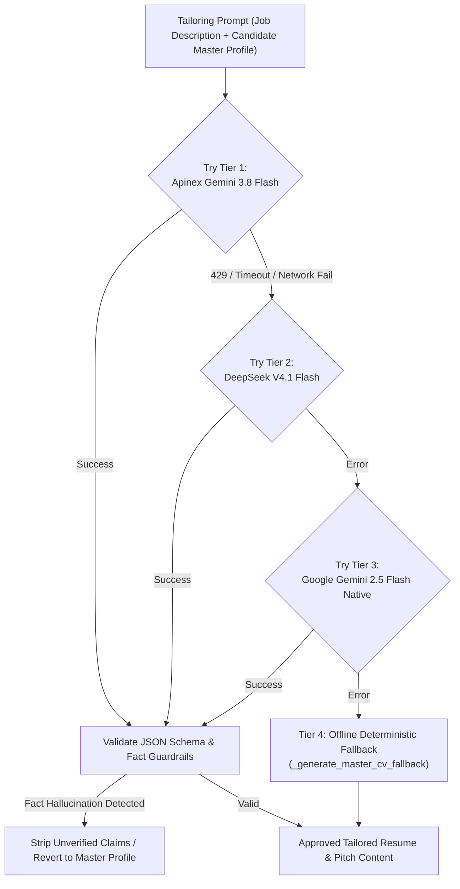
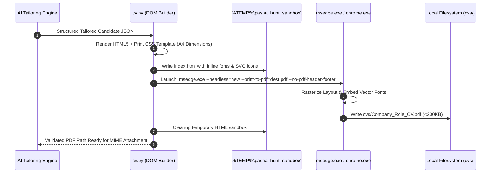
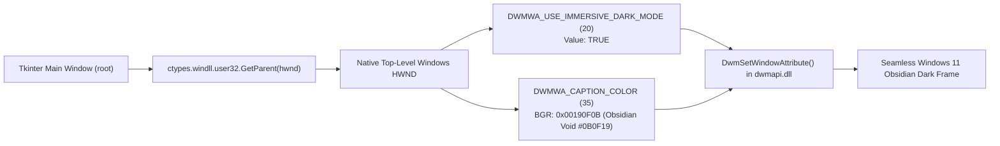
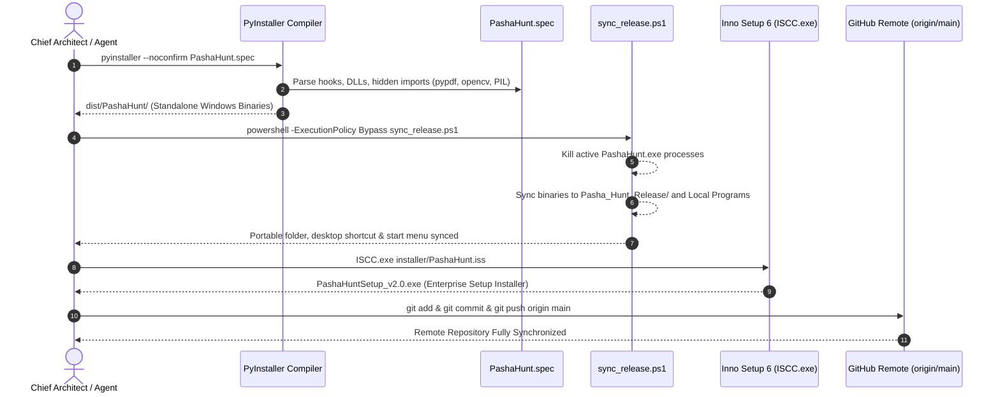

# 🏗️ Pasha Hunt 2.0: System Architecture & Technical Specification

> **Autonomous AI Career Agent, Direct-Email Sourcing Platform & High-Impact ATS Application Engine**  
> **Author & Chief Architect:** Muhammad Mubashar (*Pasha Dev*)  
> **Target Environment:** Windows 10 / Windows 11 (x64)  
> **Document Status:** Production-Ready Architectural Reference  

---

## 1. System Philosophy & High-Level Architecture

Pasha Hunt is engineered as a **local-first, autonomous desktop agent** designed to eliminate the algorithmic and operational friction of modern technical job hunting.

---

## 2. Class & Module Architecture

---

## 3. Autonomous Sourcing Matrix (18 Concurrent Feeds)

---

## 4. Socket DNS MX Email Deliverability Engine

---

## 5. Multi-Model AI Routing & Zero-Hallucination Hierarchy

> [!NOTE]
> **Anti-Hallucination Protocol:** The LLM is strictly constrained from inventing new companies, dates of employment, universities, or unverified technical skills. Its scope is restricted to:
> 1. Selecting the most relevant projects for the target role.
> 2. Re-ordering bullet points based on JD technology overlap.
> 3. Crafting a personalized introduction paragraph highlighting verified qualifications.

---

## 6. Headless Chromium / Edge Print Compilation Pipeline

---

## 7. Windows 11 DWM Immersive Dark Architecture

---

## 8. Build, Release & Packaging CI/CD Workflow

---
*End of System Architecture Specification — Pasha Hunt 2.0*
