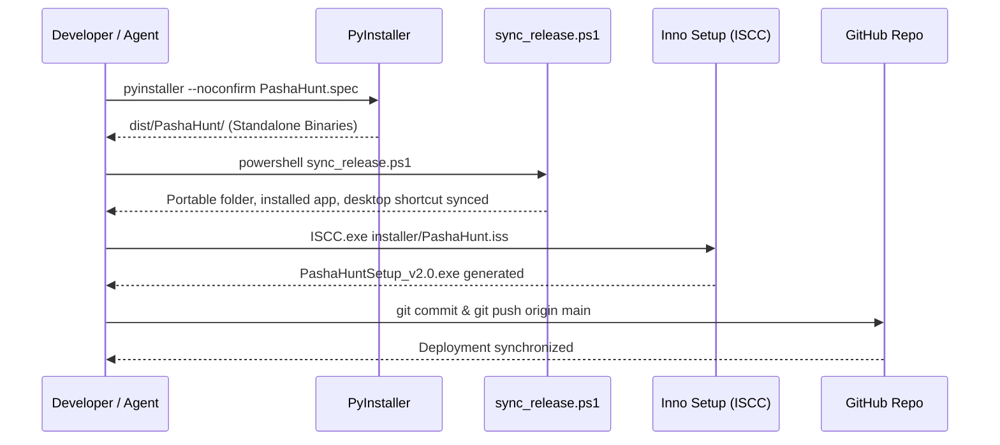

```mermaid
graph TB
    subgraph SOURCES ["1. Autonomous Sourcing Matrix (18 Concurrent Feeds)"]
        S1["Remotive / RemoteOK / Himalayas"]
        S2["WeWorkRemotely / WorkingNomads / 4DayWeek"]
        S3["Enterprise ATS (Lever, Greenhouse, Ashby)"]
        S4["Hacker News Who Is Hiring (Algolia API)"]
        S5["Gemini / Apinex Google Sourcing"]
        S6["Pakistan Tech Hub & Software Houses"]
        S7["Developer Community Posts (Facebook / LinkedIn)"]
    end

    subgraph PREFILTER ["2. Ingestion & Filtering Engine"]
        F1["Keyword Matcher (Title vs Body)"]
        F2["Geolocation & Work Mode (Remote / Hybrid / Onsite)"]
        F3["Age Filter (<= 30 Days)"]
        F4["Experience Cap Heuristic"]
    end

    subgraph EMAIL_VERIFY ["3. Email Extraction & Deliverability Engine"]
        E1["Regex & Obfuscation Parser"]
        E2["Dummy Domain Blacklist Filter"]
        E3["Live DNS Socket Resolution (verify_email_domain)"]
        E4["Badge Classifier: Verified HR vs Portal Apply"]
    end

    subgraph REASONING ["4. Fact-Grounded AI Reasoning Engine"]
        R1["Apinex / Gemini Multi-Model Hierarchy"]
        R2["Strict Zero-Hallucination Guardrails"]
        R3["Master Profile Grounding (profile.json)"]
        R4["Offline Fallback Engine"]
    end

    subgraph ATS_ENGINE ["5. ATS 95+ Resume Scorer & Optimizer"]
        A1["Action Verb Evaluator (100% Active)"]
        A2["Quantifiable Metrics Scanner (%, $, latency, scale)"]
        A3["Google XYZ Bullet Rewriter"]
        A4["ATS Readiness Rank (Elite / Strong / Average)"]
    end

    subgraph COMPILER ["6. Document Generation & Outreach"]
        C1["A4 Print CSS DOM Generator"]
        C2["Headless Chromium / Edge PDF Compiler"]
        C3["RFC 2822 MIME & Attachment Builder"]
        C4["Gmail IMAP Draft Injection"]
    end

    subgraph TRACKER ["7. Ledger & Recruiter Response Tracking"]
        T1["tracker.csv Audit Ledger"]
        T2["IMAP Inbound Response Thread Scanner"]
        T3["Live Hero Metrics Dashboard"]
    end

    SOURCES --> PREFILTER
    PREFILTER --> EMAIL_VERIFY
    EMAIL_VERIFY --> REASONING
    REASONING --> ATS_ENGINE
    ATS_ENGINE --> COMPILER
    COMPILER --> TRACKER
```

# 🏗️ Pasha Hunt 2.0: System Architecture & Technical Specification

> **Autonomous AI Career Agent, Direct-Email Sourcing Platform & High-Impact ATS Application Engine**  
> **Author & Chief Architect:** Muhammad Mubashar (*Pasha Dev*)  
> **Target Environment:** Windows 10 / Windows 11 (x64)  
> **Document Status:** Production-Ready Architectural Reference  

---

## 1. System Philosophy & High-Level Architecture

Pasha Hunt is designed from first principles as a **local-first, autonomous desktop agent** that turns job hunting from a manual, high-friction chore into an automated, highly-targeted background pipeline.

### Core Value Proposition
1. **Direct-to-Recruiter Sourcing:** Bypasses recruiter black holes by pinpointing verified direct hiring emails (`hr@*`, `careers@*`, `talent@*`).
2. **Domain-Verified Deliverability:** Pre-validates every email domain via active DNS socket resolution before displaying or drafting, completely preventing *"Address not found"* (550 bounce) errors.
3. **100% ATS-Optimized Applications:** Audits candidate experience against top enterprise ATS parsers (Workday, Greenhouse, Lever, Taleo) and elevates bullets to the **Google XYZ Formula** (`Accomplished [X] measured by [Y] doing [Z]`).
4. **Tailored Local PDF Generation:** Compiles tailored A4 PDF resumes using headless Chromium/Edge without external cloud dependencies.
5. **Zero-Hallucination Integrity:** Grounded strictly in the candidate's verified `profile.json`.

---



---

## 2. Component Breakdown & Data Models

### 2.1 File System Topology
```
%APPDATA%\Job Hunter\   (or local repo directory during dev)
├── config.json          # User search preferences, API keys, thresholds
├── profile.json         # Candidate master facts (verified experience, skills, contact)
├── jobs.json            # Active & cached job listings state machine
├── tracker.csv          # Permanent application audit ledger
├── gemini_cache.json    # Cached LLM responses for deduplication
├── google_cache.json    # Cached Google Search Sourcing results
├── bot.lock             # Atomic file lock preventing concurrent process collision
└── cvs/                 # Compiled tailored PDF CVs and cover letters
```

### 2.2 Data Contract Schemas

#### A. `profile.json` (Candidate Master Facts)
```json
{
  "name": "Muhammad Mubashar",
  "default_title": "AI Agentic Developer | Full-Stack Software Engineer",
  "contact": {
    "phone": "+92 308 4453846",
    "email": "pashadev804@gmail.com",
    "linkedin": "https://linkedin.com/in/pasha-dev",
    "github": "https://github.com/pasha804",
    "portfolio": "https://pasha-portfolio-v10.vercel.app"
  },
  "location": "Lahore, Pakistan (Open to Worldwide Remote)",
  "years": "4+",
  "default_summary": "Autonomous AI Agentic Developer and Full-Stack Software Engineer...",
  "experience": [
    {
      "id": "pasha-dev",
      "company": "Pasha Dev",
      "place": "Lahore / Remote",
      "title": "Lead Software Engineer",
      "dates": "2023 — Present",
      "bullets": [
        "Architected and delivered 6+ production-grade full-stack web, AI agentic, and desktop applications using Python, FastAPI, and Next.js, optimizing delivery velocity by 40%."
      ]
    }
  ],
  "projects": [
    {
      "id": "pasha-hunt",
      "name": "Pasha Hunt 2.0 (Autonomous AI Job Hunter)",
      "text": "Engineered autonomous desktop career agent..."
    }
  ],
  "skills": {
    "Backend & APIs": ["Python", "FastAPI", "PostgreSQL", "Redis", "Docker"]
  },
  "education": "BS Information Technology | Virtual University of Pakistan"
}
```

#### B. `jobs.json` (Job Listing Entity)
```json
{
  "id": "pk-systemslimited-fullstackdeveloper",
  "source": "pakistan_tech",
  "title": "Full Stack Developer (React / Python / FastAPI)",
  "company": "Systems Limited",
  "url": "https://www.systemsltd.com/careers",
  "email": "careers@systemsltd.com",
  "email_verified": true,
  "location": "Lahore, Pakistan (Onsite - Seepz)",
  "mode": "onsite",
  "date": "2026-11-10T12:00:00Z",
  "status": "ready",
  "fit_score": 94,
  "text": "Full job description text..."
}
```

---

## 3. The 7 Engineering Pipelines

### 3.1 Pipeline 1: Multi-Source Concurrency & Polling
* **Thread Pool Concurrency:** Uses `concurrent.futures.ThreadPoolExecutor(max_workers=5)` for network I/O bound sources.
* **Throttling & Backoff:** Dedicated per-host pacing (`MIN_GAP = 1.5s`, company boards `0.3s`).
* **Caching Matrix:** Remotive (6 hr TTL), Google Sourcing (4 hr TTL), Gemini Analysis (30 day TTL).

### 3.2 Pipeline 2: Prefiltering & Geolocation Heuristics
* **Two-Pass Matcher:**
  * *Pass 1 (Title Filter):* Matches user target keywords against job title using compiled regex with word-boundary checks.
  * *Pass 2 (Context Heuristic):* Matches stack keywords inside the job body.
* **Pakistan / Lahore Geolocation Unlock:**
  * Detects on-site / hybrid openings in Lahore, Karachi, and Islamabad, classifying them as open to the candidate.
  * Detects international roles offering visa sponsorship or relocation.

### 3.3 Pipeline 3: Email Extraction & DNS MX Deliverability
* **Regex Extraction:** Extracts standard and obfuscated emails (`[at]`, `(dot)`).
* **Blacklist Filtering:** Rejects dummy placeholders (`careers@company.com`, `example.com`, `domain.com`, `test.com`, `noreply@*`).
* **Live Socket DNS Resolution (`verify_email_domain`):**
  * Invokes `socket.getaddrinfo(domain, 80)` with a 1.5-second timeout.
  * Caches verified domains in memory (`_domain_cache`).
  * If the domain fails DNS resolution, the email is rejected, preventing Mailer-Daemon 550 bounces.

### 3.4 Pipeline 4: PDF Ingestion & Document Parsing
* **Direct PDF Text Extraction (`pypdf`):**
  * Extracts raw text from multi-page PDF CVs.
  * Avoids binary attachment drops when communicating with OpenAI-compatible proxies (Apinex).
* **Deterministic Fallback (`_parse_cv_text_to_profile`):**
  * Guarantees 100% upload success even during API rate limits or network dropouts.

### 3.5 Pipeline 5: ATS 95+ Resume Scorer & Google XYZ Optimizer
* **Scoring Dimensions:**
  * Contact Completeness (15 pts)
  * Professional Summary Impact (15 pts)
  * Experience Bullet Verbs & Metrics (35 pts)
  * Skills Categorization (20 pts)
  * Education & Certifications (15 pts)
* **Google XYZ Formula:** Transforms bullets into `Accomplished [X] as measured by [Y] by doing [Z]`.

### 3.6 Pipeline 6: Headless Chromium PDF Compilation
* **Headless Browser Printing:** Uses Microsoft Edge / Chrome in headless mode (`--headless=new --print-to-pdf`).
* **Pixel-Perfect A4 Geometry:** CSS rules configured for `@page { size: A4; margin: 12mm 15mm; }`.

### 3.7 Pipeline 7: Outreach & Bi-Directional Tracking
* **RFC 2822 MIME Assembly:** Builds multipart messages containing tailored cover letter and attached PDF CV.
* **IMAP Draft Injection:** Saves messages directly to Gmail `[Gmail]/Drafts` via IMAP `APPEND`.
* **Inbound Reply Scanner:** Scans IMAP threads for recruiter responses (`Re: Application: ...`), updating `tracker.csv`.

---

## 4. UI/UX Design System: Pasha Elite

```
+-----------------------------------------------------------------------------------+
|  [LOGO] Pasha Hunt 2.0 (Apinex Edition)                     [Auto-run: ON (30m)]  |
|  [🔍 Find Jobs]  [✉ Auto-Draft]  [⏹ Stop]  [📁 Open ▾]  [⚙ Settings]  [❔ Help ▾]   |
|-----------------------------------------------------------------------------------|
|  Your CV: [📤 Upload CV]  [🎯 ATS 95+ Optimizer]  [👤 My Profile]  [📝 Tailor...] |
|  AI Model: [free/gemini-3.8-flash (Apinex)                    ▾] [↻ Check Models] |
|-----------------------------------------------------------------------------------|
|  📊 ATS Score: 100% (Elite)  | 🎯 Matches: 24 | ✉️ Verified HR: 18 | 🚀 Ready: 12  |
|===================================================================================|
|  STATUS   | MATCH  | COMPANY          | ROLE               | EMAIL / LINK         |
|-----------+--------+------------------+--------------------+----------------------|
|  ✉ Ready  | ★★ Str | Systems Limited  | Full Stack Dev     | careers@systemsltd...|
|  ✉ Ready  | ★★ Str | InvoZone         | Python Backend     | careers@invozone.com |
|  🌐 Site  | ★ Part | Motive           | AI Software Eng    | https://motive.com...|
|-----------------------------------------------------------------------------------|
|  Detail Pane: Systems Limited · Lahore, Pakistan                                  |
|  Email: careers@systemsltd.com  ·  ✔ Verified Recruiter Domain (Deliverable)      |
|  [ ✉ Draft Email + CV ]   [ 📄 Make PDF CV ]   [ 🌐 Open URL ]   [ ✔ Applied ]     |
|-----------------------------------------------------------------------------------|
|  Run Log: [12:30:15] Sourced 24 active roles. 18 direct recruiter emails verified.|
+-----------------------------------------------------------------------------------+
```

### Color Tokens
* **Background:** Obsidian Void `#0B0F19`
* **Card Surface:** Midnight Slate `#111827`
* **Border:** Dark Slate `#1E293B`
* **Primary Accent:** Cyber Azure `#38BDF8`
* **Success / Verified:** Neon Emerald `#10B981`
* **Warning:** Vivid Amber `#F59E0B`
* **Alert / Stop:** Coral Rose `#F43F5E`
* **Text:** Pure Titanium White `#F8FAFC` / Muted Slate `#94A3B8`

---

## 5. Security, Guardrails & AgentShield

1. **Local-First Privacy:** Zero remote telemetry. Candidate facts never leave local storage.
2. **Deterministic Sandboxing:** Fallbacks ensure no data loss even without internet connectivity.
3. **Protected Secrets:** App passwords and API keys are stored locally in user `%APPDATA%` and excluded from git.
4. **Anti-Hallucination Barrier:** Strict prompt guards prohibit inventing qualifications or job history.

---

## 6. Build, Release & Packaging Workflow


