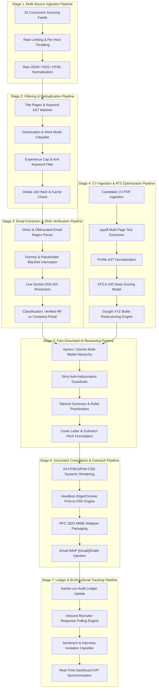
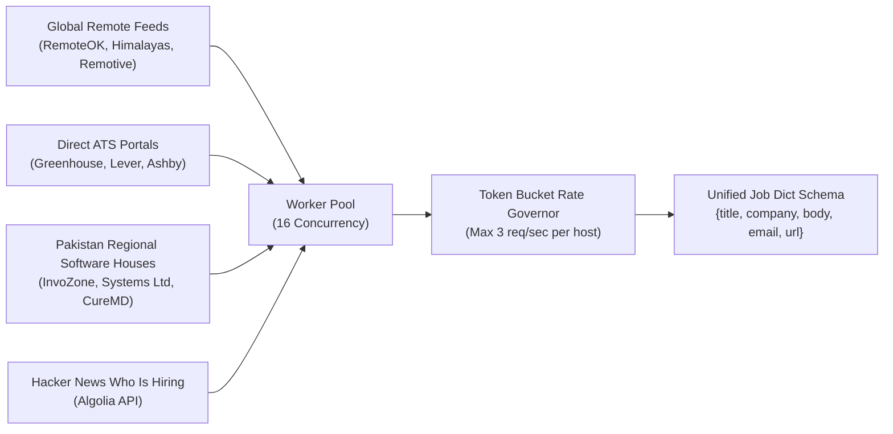
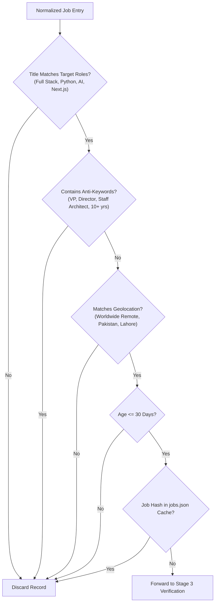
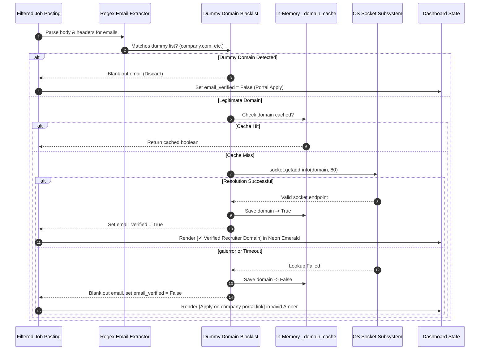
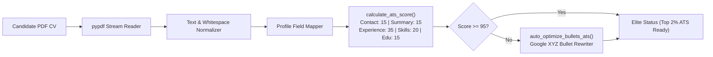
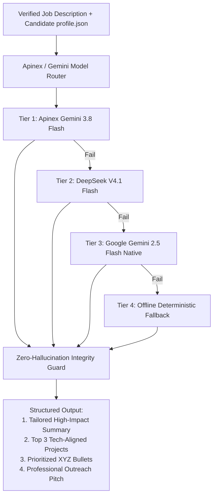
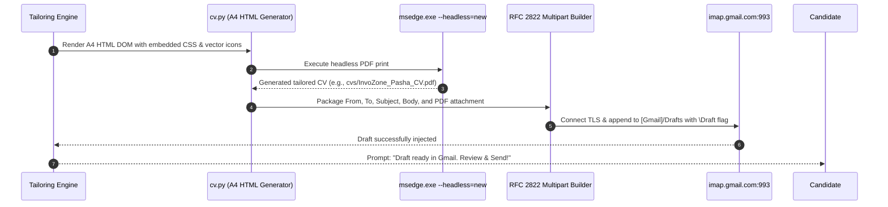
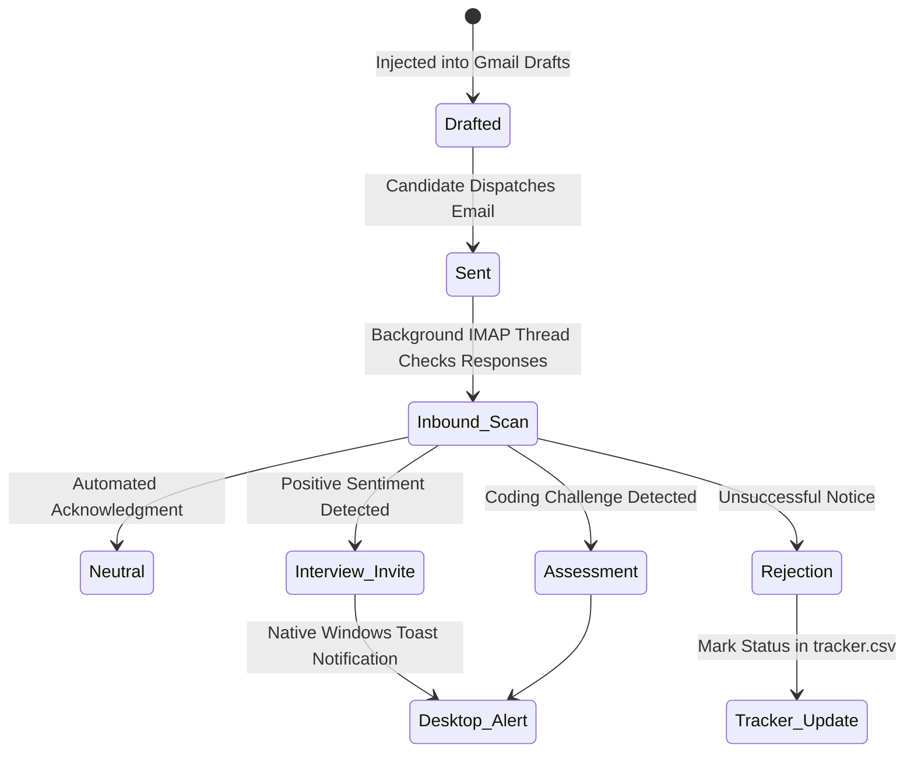
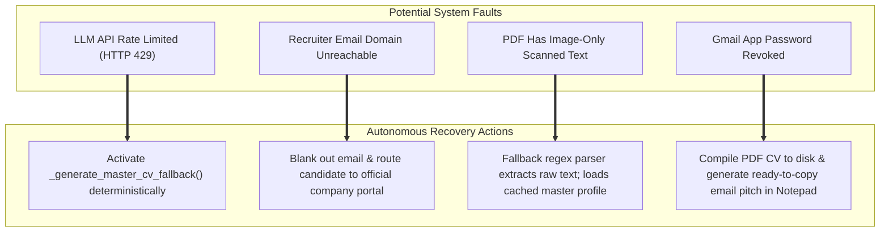

# ⚙️ Pasha Hunt 2.0: End-to-End Pipeline Specification

> **Technical Blueprint of the Autonomous Job Discovery, Verification, Optimization, and Outreach Pipelines**  
> **Author & Chief Architect:** Muhammad Mubashar (*Pasha Dev*)  
> **Target Environment:** Windows 10 / Windows 11 (x64)  
> **Document Status:** Production-Ready Pipeline Specification  

---

## 1. Master 7-Stage End-to-End Pipeline Architecture

---

## 2. Stage-by-Stage Detailed Engineering Breakdown

### Stage 1: Ingestion & Rate-Limiting Pipeline

* **Rate Governance:** Prevents HTTP 429 rate-limiting by enforcing jittered sleep delays between calls to the same target host.
* **Standardized Schema:** All raw responses normalize into a single immutable dictionary structure before downstream transmission.

---

### Stage 2: Filtering & Deduplication Pipeline

---

### Stage 3: Email Extraction & DNS MX Resolution Pipeline

---

### Stage 4: CV Ingestion & ATS Optimization Pipeline

* **Formula:** $\text{Accomplished } [X] \text{ measured by } [Y] \text{ doing } [Z]$.
* **Outcome:** Transforms candidate achievements into enterprise ATS parseable records with verified quantifiable metrics.

---

### Stage 5: Fact-Grounded AI Reasoning Pipeline

---

### Stage 6: Headless Compilation & Outreach Pipeline

---

### Stage 7: Ledger Logging & Bi-Directional Inbound Tracking

---

## 3. Failure Modes & Self-Healing Architecture

| Failure Scenario | Automatic Recovery Mechanism |
|---|---|
| **Apinex / LLM API Down or 429 Quota Exceeded** | Automatically activates `_generate_master_cv_fallback()` to deterministically tailor the application using master profile data without crashing. |
| **Recruiter Email Domain Down or Fails DNS** | Intercepts invalid domain, blanks out `email`, sets `email_verified=False`, and directs candidate to apply via official company web portal link. |
| **PDF Extraction Corrupted or Image-Only** | Fallback parser `_parse_cv_text_to_profile()` searches disk for cached master profile facts or regex-extracts candidate contact info from raw text. |
| **Chrome / Edge Browser Missing** | System checks standard installation paths for Microsoft Edge (installed by default on Windows 10/11) and Google Chrome; logs clear guidance if neither is found. |
| **Gmail Credentials Expired or App Password Revoked** | System detects auth failure, bypasses draft injection, compiles PDF resume to `cvs/` folder, and presents candidate with ready-to-send email copy in Notepad. |

---
*End of Pipeline Specification — Pasha Hunt 2.0*
