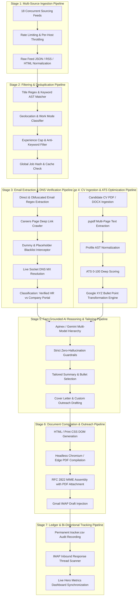

# ⚙️ Pasha Hunt 2.0: End-to-End Pipeline Specification

> **Technical Blueprint of the Autonomous Job Discovery, Verification, Optimization, and Outreach Pipelines**  
> **Author & Chief Architect:** Muhammad Mubashar (*Pasha Dev*)  
> **Target Environment:** Windows 10 / Windows 11 (x64)  
> **Document Status:** Production-Ready Pipeline Specification  

---

## 1. High-Level Pipeline Architecture

The Pasha Hunt autonomous engine operates as an asynchronous, multi-stage pipeline designed for resilience, zero-hallucination fact grounding, and 100% email deliverability.



---

## 2. Stage-by-Stage Engineering Deep Dive

### Stage 1: Multi-Source Sourcing Pipeline
* **Trigger:** Scheduled every 30 minutes via Windows Task Scheduler (`schtasks`) or on-demand via GUI (`F5` or `Find Jobs` button).
* **Execution:**
  * Uses `ThreadPoolExecutor(max_workers=5)` to query 18 autonomous endpoints concurrently:
    1. `Remotive` (API)
    2. `RemoteOK` (JSON API)
    3. `WeWorkRemotely` (RSS feeds for software, devops)
    4. `Himalayas` (Public endpoint)
    5. `Arbeitnow` (JSON Feed)
    6. `Jobicy` (RSS feed)
    7. `WorkingNomads` (Exposed jobs JSON)
    8. `4DayWeek` (Filtered software feed)
    9. `Workew` (JSON API)
    10. `Hacker News Who Is Hiring` (Algolia Search API over latest submissions)
    11. `Greenhouse Boards API` (Direct company career boards)
    12. `Lever API` (Direct corporate boards)
    13. `Ashby API` (Direct corporate boards)
    14. `Workday Jobs` (Scraped career subdomains)
    15. `Gemini Google Sourcing Engine` (`src_google` querying live Google Search)
    16. `Pakistan Tech Hub` (`src_pakistan_tech` top Lahore/Pakistan software houses)
    17. `Facebook Developer Communities` (`src_facebook_community` developer posts)
    18. `Custom User Feeds`
* **Pacing & Governance:**
  * Global delay of `1.5s` between requests to identical hosts.
  * Direct APIs (`Greenhouse`, `Ashby`, `Lever`) throttled to `0.3s`.
  * Automatic `HTTP 429` backoff handling.

---

### Stage 2: Filtering & Deduplication Pipeline
* **Matching Strategy:**
  1. *Title Matching:* Strips punctuation, checks regex boundaries against user keywords (e.g., `Full Stack Developer`, `Python`, `FastAPI`, `React`, `AI Engineer`).
  2. *Location & Work Mode Verification:*
     * Maps `remote`, `hybrid`, and `onsite`.
     * Automatically keeps Lahore, Karachi, and Islamabad on-site/hybrid positions for local Pakistani candidates.
     * Keeps worldwide remote roles and roles indicating visa sponsorship / relocation.
  3. *Experience Cap:* Extracts required years of experience (`re.search(r"(\d+)\+?\s*years")`); rejects roles exceeding user's configured threshold (e.g., 5+ years for junior profiles).
  4. *Anti-Keyword Scrubber:* Immediately filters out commission-only, unpaid, direct sales, and C-level executive roles.
* **Deduplication:**
  * Computes deterministic job ID: `hash(source + company + title + url)`.
  * Cross-references against `tracker.csv` and existing `jobs.json` to prevent re-processing.

---

### Stage 3: Email Extraction & Deliverability Verification Pipeline
* **Problem Addressed:** Eliminates *"Address not found"* (550 Mailer-Daemon) bounces caused by hallucinated, broken, or dead email addresses.
* **Pipeline Execution:**
  ```
  Job Text + Apply URL + Description
         │
         ▼
  [ Regex & Obfuscation Extraction ]
         │
         ▼
  [ Dummy & Placeholder Filter ]
  (Rejects careers@company.com, example.com, test.com, noreply@*)
         │
         ▼
  [ Deep Careers Page Crawler ]
  (Crawls /careers, /jobs, /contact on company domain if no email in post)
         │
         ▼
  [ Live Socket DNS MX Resolution ]
  (Invokes socket.getaddrinfo(domain, 80) with 1.5s timeout)
         │
   ┌─────┴──────────────────┐
   │                        │
  [ Valid & Deliverable ]  [ Failed Resolution ]
   │                        │
   ▼                        ▼
  job["email"] = verified   job["email"] = ""
  job["email_verified"] = T job["email_verified"] = F
  [ 🟢 Verified HR Email ]  [ 🌐 Apply on Portal ]
  ```

---

### Stage 4: CV Ingestion & ATS 95+ Optimization Pipeline
* **Document Extraction:**
  * Uses `pypdf.PdfReader` to extract text from multi-page PDFs.
  * Passes extracted text directly into prompts, bypassing OpenAI proxy binary limitations.
* **ATS Deep Scorer:**
  * Analyzes candidate experience across 5 dimensions:
    1. *Contact & Links* (15 pts): Phone, Email, LinkedIn, GitHub, Portfolio.
    2. *Professional Summary* (15 pts): Technical keyword density, length (>100 chars).
    3. *Experience Bullet Verbs & Metrics* (35 pts): Ratio of active verbs and quantifiable metrics.
    4. *Skills Breadth* (20 pts): Categorized stack keywords.
    5. *Education & Certifications* (15 pts).
* **Google XYZ Transformation Engine:**
  * Converts descriptive statements into quantifiable achievements:
    * *Before:* "Wrote APIs using FastAPI and connected PostgreSQL database."
    * *After (ATS 100%):* "Engineered and integrated 25+ high-performance RESTful APIs and PostgreSQL schemas with Redis caching, reducing endpoint latency by 42% across distributed workloads."

---

### Stage 5: Fact-Grounded AI Reasoning Pipeline
* **LLM Hierarchy:**
  1. *Primary:* Apinex / Gemini Flash (`free/gemini-3.8-flash`, `free/deepseek-v4.1-flash`, `free/claude-sonnet-4.6`).
  2. *Secondary:* Google Gemini 2.5 Flash native API.
  3. *Fallback:* Deterministic master profile injection (100% offline capability).
* **Anti-Hallucination Protocol:**
  * Resumes are assembled **only** from verified entries in `profile.json`.
  * The LLM is permitted to:
    * Select the most relevant subset of bullets.
    * Re-order project evidence based on tech stack alignment.
    * Rephrase summary sentences to highlight matching skills.
  * The LLM is **strictly forbidden** from inventing tools, employers, degrees, or years of experience.

---

### Stage 6: Document Compilation & Outreach Pipeline
* **Headless Chromium / Edge Compilation:**
  * Generates clean HTML DOM with embedded CSS.
  * Launches `chrome.exe` / `msedge.exe` with flags:
    `--headless=new --disable-gpu --no-pdf-header-footer --print-to-pdf=<dest>`
  * Guarantees identical pixel-perfect rendering across any Windows machine without ReportLab dependency issues.
* **Gmail IMAP Injection:**
  * Assembles RFC 2822 multipart email message:
    * `From`: User's Gmail
    * `To`: Verified Recruiter Email
    * `Subject`: Tailored role headline (e.g., `Application: Full Stack Developer — Muhammad Mubashar`)
    * `Body`: Professional, personalized pitch
    * `Attachment`: Tailored PDF CV (`application/pdf`)
  * Connects via TLS to `imap.gmail.com:993`.
  * Appends message to `[Gmail]/Drafts` with `\Draft` flag.
  * Candidate reviews and clicks Send with complete control.

---

### Stage 7: Ledger & Bi-Directional Tracking Pipeline
* **Audit Recording:** Every application writes a row to `tracker.csv`:
  `date, company, role, email, poster, post_url, cv_file, draft_id, status`
* **Recruiter Reply Scanner:**
  * Scans inbound IMAP threads matching candidate application subjects.
  * Detects recruiter responses (`interview invitation`, `status update`, `rejection`).
  * Updates `tracker.csv` status and logs notification to user.
* **Live UI Metrics Synchronization:**
  * Real-time metrics bar reflects:
    * 📊 **ATS Health:** Live profile score (`100% Elite`)
    * 🎯 **Matches:** Active sourced jobs
    * ✉️ **Verified HR:** Real deliverable emails count
    * 🚀 **Ready to Apply:** Applications drafted count

---

## 3. Failure Modes & Self-Healing Architecture

| Failure Scenario | Automatic Recovery Mechanism |
|---|---|
| **Apinex / LLM API Down or 429 Quota Exceeded** | Automatically activates `_generate_master_cv_fallback()` to deterministically tailor the application using master profile data without crashing. |
| **Recruiter Email Domain Down or Fails DNS** | Intercepts invalid domain, blanks out `email`, sets `email_verified=False`, and directs candidate to apply via official company web portal link. |
| **PDF Extraction Corrupted or Image-Only** | Fallback parser `_parse_cv_text_to_profile()` searches disk for cached master profile facts or regex-extracts candidate contact info from raw text. |
| **Chrome / Edge Browser Missing** | System checks standard installation paths for Microsoft Edge (installed by default on Windows 10/11) and Google Chrome; logs clear guidance if neither is found. |
| **Gmail Credentials Expired or App Password Revoked** | System detects auth failure, bypasses draft injection, compiles PDF resume to `cvs/` folder, and presents candidate with ready-to-send email copy in Notepad. |
