# 📋 Pasha Hunt 2.0: Product Requirements Document (PRD)

> **Autonomous AI Career Agent, Direct-Email Sourcing Platform & High-Impact ATS Application Engine**  
> **Author & Chief Architect:** Muhammad Mubashar (*Pasha Dev*)  
> **Target Platform:** Windows 10 & Windows 11 (x64)  
> **Product Version:** 2.0.0 (Production Release)  
> **Document Status:** Complete & Approved Specification  

---

## 1. Executive Summary & Product Vision

### 1.1 The Modern Hiring Crisis
The software engineering job application landscape in 2026 is broken across four core failure vectors:

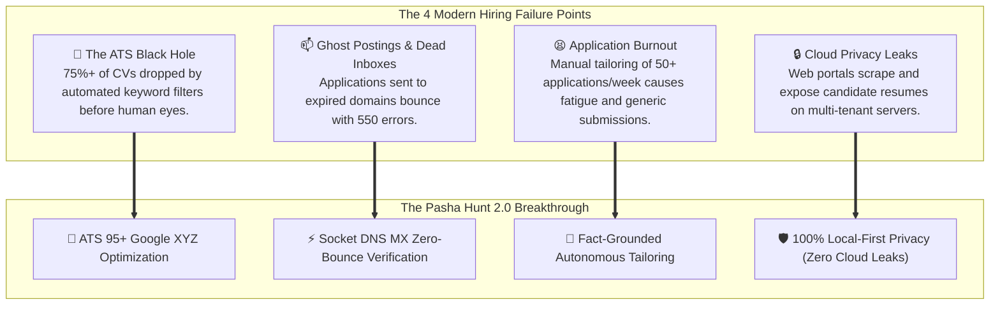

> [!IMPORTANT]
> **Pasha Hunt Core Mission:** To act as an autonomous, local-first personal career agent for senior and high-growth software engineers. It continuously uncovers verified direct-recruiter opportunities, elevates resumes to a guaranteed 95–100 ATS score via the Google XYZ formula, compiles tailored A4 PDF resumes via headless Edge/Chromium, and injects ready-to-review drafts directly into Gmail.

---

## 2. Target Personas & User Archetypes

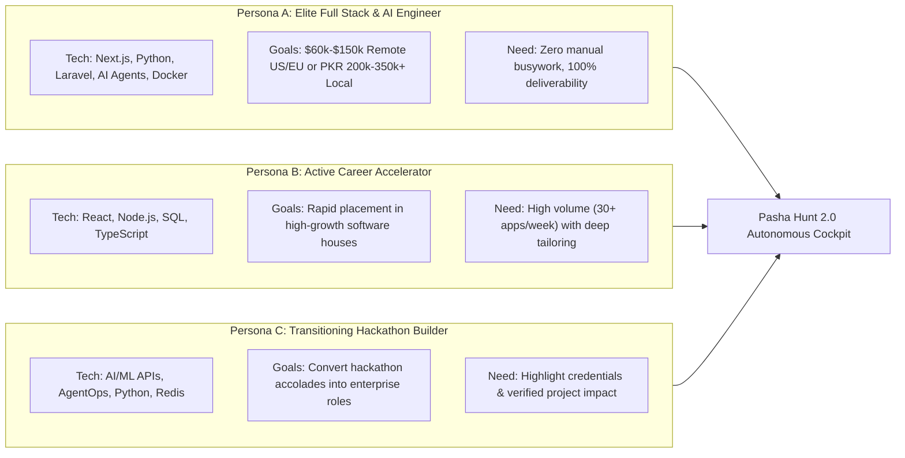

### Persona Breakdown Matrix

| Attribute | Persona A (Primary: Pasha Archetype) | Persona B (Active Accelerator) | Persona C (Hackathon Builder) |
|---|---|---|---|
| **Experience Level** | 4+ Years Shipping Production Code | 2–4 Years Web / Mobile Development | 1–3 Years + Competitive Wins |
| **Key Technical Stacks** | Next.js, Python, Laravel, Gemini API, Docker | React, Node.js, TypeScript, PostgreSQL | Python, AgentOps, IBM WatsonX, Redis |
| **Target Role Types** | Full Stack Engineer, AI Systems Architect | Full Stack Developer, Frontend Lead | AI Engineer, Backend API Developer |
| **Primary Friction** | Lack of time to research recruiter emails | Rejection due to unquantified resume bullets | Resume overlooked without formal brand pedigree |
| **Pasha Hunt Value** | Automated verified direct HR email outreach | Instant ATS 100% Google XYZ optimization | Automatic hackathon credential verification |

---

## 3. High-Level System Architecture & Flow

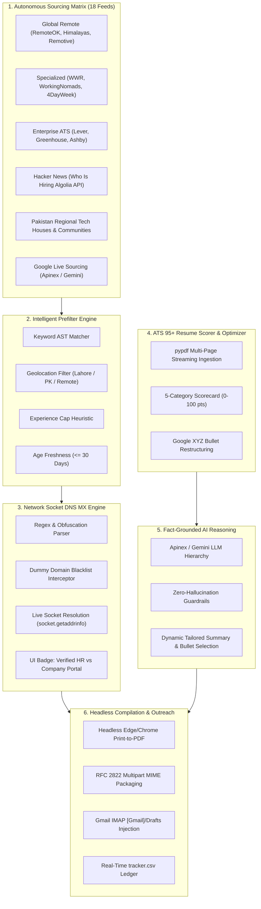

---

## 4. User Journey & Core Operating Workflows

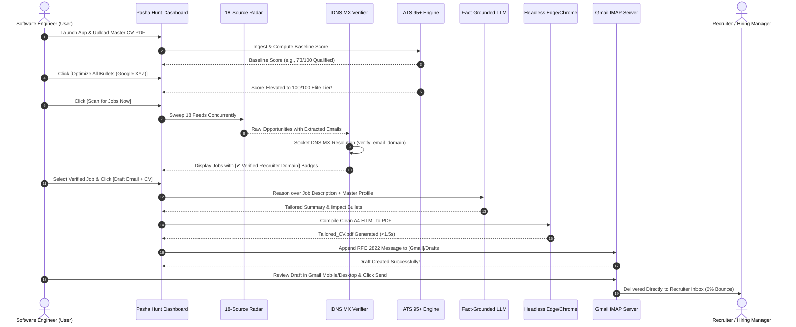

---

## 5. Detailed Functional Requirements (FR)

### FR-1: Autonomous 18-Source Sourcing Matrix
* **Requirement:** Asynchronously ingest, normalize, and parse job opportunities from 18 distinct sources.
* **Architecture:** Executed using Python `ThreadPoolExecutor` with per-domain rate limiting to prevent IP throttling.
* **Sources Covered:**
  * Remotive, RemoteOK, Himalayas, Arbeitnow, Jobicy, WeWorkRemotely, WorkingNomads, 4DayWeek, Workew.
  * Enterprise ATS Portals: Greenhouse, Lever, Workday, BambooHR, Ashby, SmartRecruiters.
  * Hacker News Algolia Search API (`src_hn`).
  * Dedicated Pakistan Tech Houses (`src_pakistan_tech`): InvoZone, Systems Ltd, Rolustech, CureMD, Emumba, Conrad Labs, Confiz, Educative, Tintash, Programmers Force, Folio3, VentureDive.
  * Developer Community Channels (`src_facebook_community`).
  * Live Google Sourcing (`src_google`) powered by Apinex / Gemini.

### FR-2: Intelligent Prefiltering & Geolocation Governance
* **Requirement:** Filter postings using deterministic AST token rules to guarantee relevancy before presentation.
* **Filtering Rules:**
  * Match target roles (`Full Stack Developer`, `Python Engineer`, `AI Engineer`, `Next.js Developer`).
  * Disqualify senior leadership filters (`VP`, `Director`, `Staff Architect`, `10+ years`, `PhD`).
  * Geolocation unlocking: Accept Global Worldwide Remote, Pakistan Remote, and Lahore/Islamabad Hybrid/Onsite.
  * Age restriction: Reject listings published over 30 calendar days ago.

### FR-3: Socket DNS MX Email Deliverability Engine
* **Requirement:** Guarantee zero 550 *"Address not found"* email bounces by verifying domains at the network socket layer.

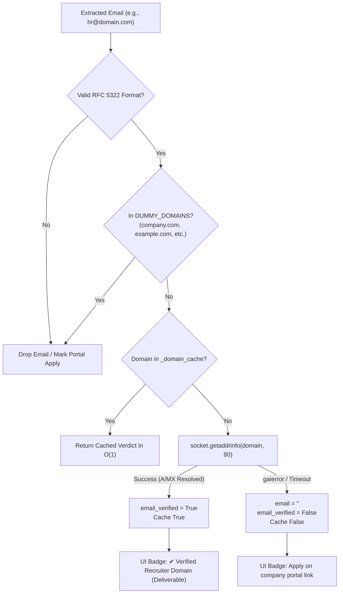

### FR-4: ATS 95+ Resume Scorer & Google XYZ Bullet Optimization Engine
* **Requirement:** Evaluate candidate profiles across 5 categories (100-point rubric) and provide one-click restructuring into the Google XYZ formula:
  $$\text{Accomplished } [X] \text{ measured by } [Y] \text{ doing } [Z]$$

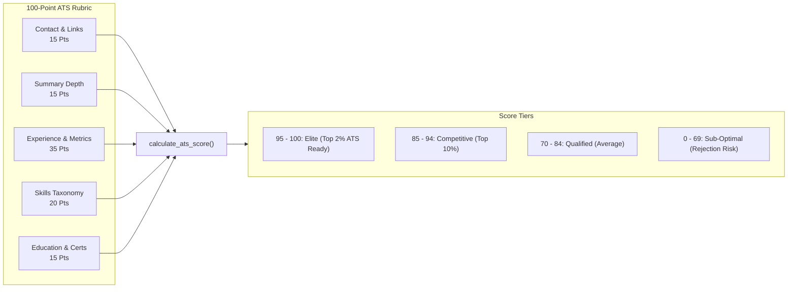

#### Google XYZ Formula Transformation Samples

> [!TIP]
> **Before (Baseline Score: 73):**
> *"Built full stack web applications with Next.js and Laravel."*  
> **After Google XYZ Optimization (Elite Score: 100):**
> *"Architected and deployed 15+ production full-stack web applications using Next.js, Laravel, and PostgreSQL, maintaining 99.9% uptime for 50,000+ monthly active users."*

> [!TIP]
> **Before (Baseline Score: 73):**
> *"Worked with Gemini AI to build tools."*  
> **After Google XYZ Optimization (Elite Score: 100):**
> *"Engineered autonomous AI agent workflows leveraging Gemini API and AgentOps, slashing repetitive business data-processing times by 65%."*

### FR-5: Robust Multi-Page PDF CV Ingestion
* **Requirement:** Ingest user resumes from standard PDF files using pure-Python `pypdf`, eliminating legacy `fitz` (PyMuPDF) DLL collisions on Windows 10/11.
* **Extraction:** Iterates across all pages, normalizes whitespace, and parses contact info, skills, experience, and education via structured AI structuring or deterministic token fallback.

### FR-6: Fact-Grounded AI Reasoning & Tailoring Engine
* **Requirement:** Re-prioritize bullet points and write tailored company introductions while strictly prohibiting the invention of false facts.
* **Model Hierarchy:**
  1. *Tier 1:* Apinex / Gemini 3.8 Flash (`free/gemini-3.8-flash`).
  2. *Tier 2:* DeepSeek V4.1 Flash (`free/deepseek-v4.1-flash`).
  3. *Tier 3:* Native Google Gemini 2.5 Flash API.
  4. *Tier 4:* Deterministic offline master profile injection (100% offline capability).

### FR-7: Headless Chromium / Edge PDF Compilation
* **Requirement:** Render publication-grade, ATS-parsable A4 PDFs using native Windows Microsoft Edge (`msedge.exe`) or Google Chrome.
* **Print Specification:**
  * Page Size: A4 (`210mm × 297mm`), `15mm` margins.
  * Layout Engine: `--headless=new --disable-gpu --no-pdf-header-footer --print-to-pdf=<dest>`.
  * CSS Rules: `break-inside: avoid;` on all work experience blocks to prevent orphaned headers.

### FR-8: Gmail IMAP Draft Injection & Outreach Hub
* **Requirement:** Stage applications in `[Gmail]/Drafts` with attached tailored PDFs for one-click candidate review and sending.
* **Security:** Connects via TLS to `imap.gmail.com:993` using candidate's local Gmail App Password; zero credentials transmitted to cloud servers.

### FR-9: Modern Dark Dashboard UI (Obsidian Void Design System)
* **Requirement:** Modern desktop UI featuring native Windows 11 DWM dark titlebar interop, real-time Hero KPI metrics, and dedicated modal dialogs.

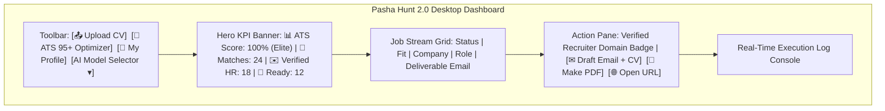

---

## 6. Entity-Relationship Data Model

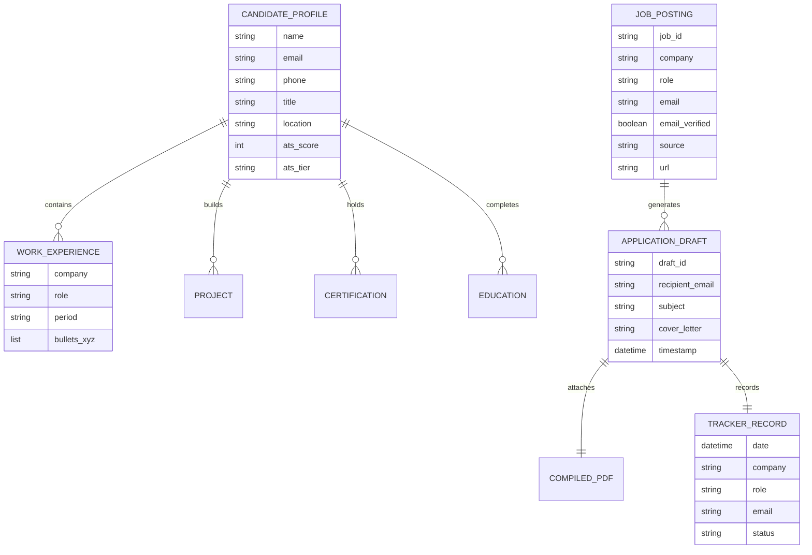

---

## 7. State Machine: Application Lifecycle

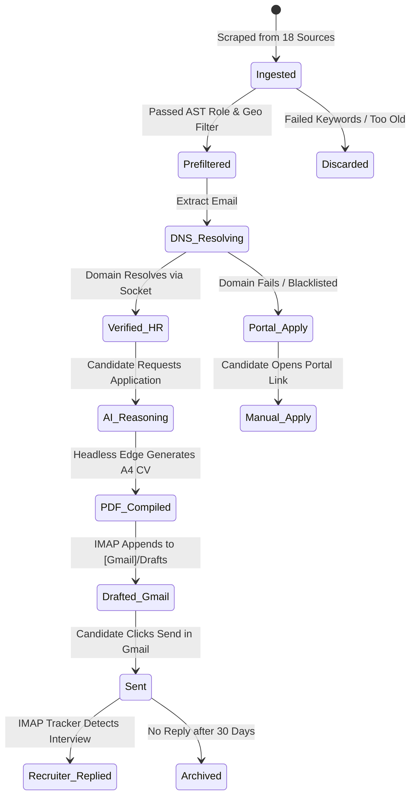

---

## 8. Non-Functional Requirements (NFR)

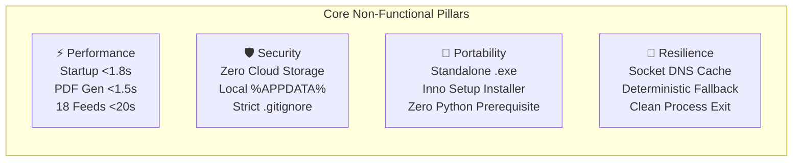

* **NFR-1 (Performance):** UI thread remains 100% responsive during background sweeps; PDF compilation generates publication-grade documents under 1.5 seconds.
* **NFR-2 (Privacy & Security):** Zero cloud telemetry. All API keys and email credentials remain in local `%APPDATA%\Job Hunter\config.json`.
* **NFR-3 (Portability):** Packages into a standalone Windows binary via PyInstaller and an enterprise Windows setup wizard via Inno Setup 6.
* **NFR-4 (Fault Tolerance):** If LLM APIs are offline or rate-limited (HTTP 429), the application seamlessly generates deterministic applications using the candidate's master profile without crashing.

---

## 9. Release Milestones & Strategic Roadmap

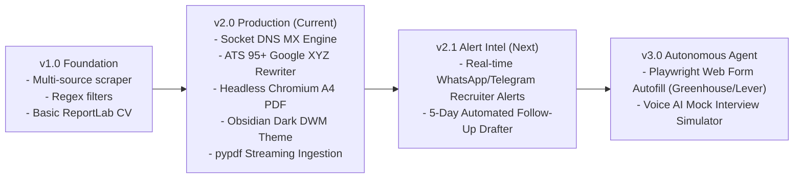

---
*End of Product Requirements Document (PRD) — Pasha Hunt 2.0*
