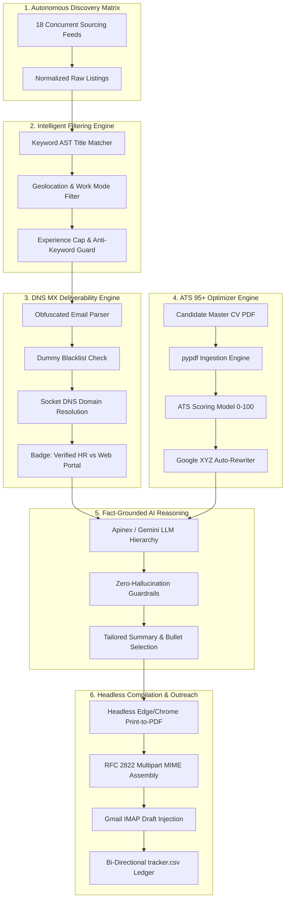

# 📋 Pasha Hunt 2.0: Product Requirements Document (PRD)

> **Autonomous AI Career Agent, Direct-Email Sourcing Platform & High-Impact ATS Application Engine**  
> **Author & Chief Architect:** Muhammad Mubashar (*Pasha Dev*)  
> **Target Platform:** Windows 10 & Windows 11 (x64)  
> **Product Version:** 2.0.0 (Production Release)  
> **Document Status:** Complete & Approved Specification  

---

## 1. Executive Summary & Product Vision

### 1.1 Problem Statement
The modern software engineering job search is broken across four distinct failure points:
1. **The ATS Black Hole:** Over 75% of submitted resumes are discarded before human review due to unparsed layouts, missing semantic keywords, or weak, non-quantified bullet points.
2. **Ghost Postings & Dead Inboxes:** Candidates waste hundreds of hours applying to expired listings or emailing invalid corporate addresses, resulting in 550 *"Address not found"* bounce errors.
3. **Application Fatigue & Generic Submissions:** Manually tailoring resumes and cover letters for dozens of jobs causes cognitive burnout, leading candidates to spray generic CVs that convert at less than 2%.
4. **Cloud Privacy Leaks:** Existing career platforms require candidates to upload sensitive career histories and contact details to multi-tenant cloud servers where personal data is scraped, sold, or exposed.

### 1.2 The Pasha Hunt Mission
**Pasha Hunt 2.0** is an **autonomous, local-first desktop agent** designed to act as a dedicated career orchestrator for software engineers. It flips the job hunt dynamic:
* It continuously sources high-signal engineering roles across 18 concurrent feeds.
* It resolves and validates recruiter email domains via live DNS socket queries, eliminating bounces.
* It audits candidate profiles against enterprise ATS benchmarks, upgrading bullet points to the **Google XYZ Formula** (`Accomplished [X] measured by [Y] doing [Z]`) to achieve a guaranteed 95–100 ATS score.
* It compiles tailored, pixel-perfect A4 PDF resumes using headless Chromium/Edge and injects ready-to-review drafts directly into the candidate's Gmail Drafts folder.
* **All candidate data remains 100% local on the candidate's machine.**

---

## 2. Target Personas & User Archetypes

### Persona A: The Elite Full Stack / AI Engineer (Primary Archetype)
* **Profile:** 3–6+ years of shipping real-world full-stack web and autonomous AI systems (e.g., Next.js, Python, Laravel, LLM pipelines, Docker).
* **Pain Point:** Has strong skills and hackathon accolades, but lacks time to manually search 18 job boards, research recruiter emails, and tailor resumes for each opening.
* **Goal:** High-paying remote US/EU roles ($60k–$150k/yr) and top-tier local tech house opportunities (PKR 180k–300k+/month) with minimal repetitive manual labor.

### Persona B: The Active Job Seeker
* **Profile:** Candidates in transition who need to apply to 20–50 high-quality positions weekly without sacrificing personalization or falling into ATS black holes.
* **Pain Point:** Email bounces, unorganized spreadsheets, and ghost postings on outdated boards.
* **Goal:** A unified cockpit showing live matches, verified recruiter emails, one-click PDF generation, and automated follow-up tracking.

---

## 3. High-Level System Architecture & Flow



---

## 4. Detailed Functional Requirements (FR)

### FR-1: Autonomous Multi-Source Discovery Matrix
* **Requirement:** The system MUST asynchronously scrape and aggregate job postings across 18 distinct sources every 30 minutes or on user demand.
* **Source Providers:**
  1. *Global Remote:* Remotive, RemoteOK, Himalayas, Arbeitnow, Jobicy, WeWorkRemotely, WorkingNomads, 4DayWeek, Workew.
  2. *Enterprise ATS Platforms:* Greenhouse, Lever, Workday, BambooHR, Ashby, SmartRecruiters.
  3. *Community & High-Signal Boards:* Hacker News ("Who Is Hiring" via Algolia Search API).
  4. *AI-Powered Live Web Sourcing:* Gemini / Apinex Google Search Sourcing (`src_google`).
  5. *Pakistan Regional Tech Hub:* Curated Pakistani software houses (Systems Ltd, InvoZone, CureMD, Rolustech, Emumba, Conrad Labs, Confiz, Educative, Tintash, Programmers Force, Folio3, VentureDive).
  6. *Developer Communities:* Facebook & LinkedIn recruiter posting pipelines (`src_facebook_community`).
* **Performance:** Sweeps across all 18 sources MUST complete in under 20 seconds using thread pool concurrency (`ThreadPoolExecutor`).

### FR-2: Intelligent Prefiltering & Geolocation Governance
* **Requirement:** Ingested postings MUST be rigorously filtered to eliminate irrelevant roles, over-senior positions, and geographic disqualifiers.
* **Specifications:**
  * **Role AST Matching:** Exact and fuzzy token matching against target roles (`Full Stack Developer`, `Python Engineer`, `AI Engineer`, `Next.js Developer`).
  * **Exclusion Filtering:** Reject postings containing disqualifying keywords (`Senior Director`, `VP of Engineering`, `Staff Architect`, `10+ years`, `PhD Required`).
  * **Work Mode Governance:**
    * Global remote roles open to worldwide/contract candidates.
    * Regional Pakistan roles (Lahore onsite/hybrid, Islamabad onsite/hybrid, Pakistan-wide remote).
  * **Posting Freshness:** Auto-drop listings older than 30 calendar days.

### FR-3: Socket DNS MX Email Deliverability Engine
* **Requirement:** Every extracted recruiter email MUST be pre-validated at the network layer before presenting it to the user or injecting drafts, guaranteeing zero 550 bounces.
* **Specifications:**
  * **Blacklist Interceptor:** Automatically reject dummy/template domains (`company.com`, `example.com`, `yourcompany.com`, `email.com`, `domain.com`).
  * **DNS Socket Resolution:** For every target domain (e.g. `invozone.com`), perform live socket address resolution (`socket.getaddrinfo(domain, 80)`).
  * **In-Memory Caching:** Resolved domains MUST be cached in `_domain_cache` to minimize DNS overhead during large batch runs.
  * **UI Badge Classification:**
    * Validated Domain: Display `✔ Verified Recruiter Domain (Deliverable)` with prominent green visual badge.
    * Failed or Missing Domain: Blank out email, set `email_verified = False`, and mark role as `Apply on company portal link`.

### FR-4: ATS 95+ Resume Scorer & Google XYZ Bullet Optimization Engine
* **Requirement:** The platform MUST evaluate the candidate's active CV against enterprise ATS parsing standards and provide automated bullet point restructuring.
* **Scoring Rubric (0–100 Total Points):**
  1. **Contact & Professional Links (15 pts):** Name, valid phone, email, LinkedIn, and GitHub URL presence.
  2. **Professional Summary (15 pts):** 40+ words with target role positioning and core competencies.
  3. **Experience Impact & Metrics (35 pts):**
     * Presence of work history entries (10 pts).
     * Action-verb driven bullets (10 pts).
     * Quantifiable impact metrics (percentages, dollar amounts, performance numbers, scale) (15 pts).
  4. **Categorized Skills Taxonomy (20 pts):** Structured separation of Languages, Frameworks, AI/ML Tools, Databases, and DevOps.
  5. **Education & Certifications (15 pts):** Degree title, institution, graduation date, and verified hackathon/industry certificates.
* **Google XYZ Formula Engine:**
  * The engine MUST inspect all bullet points and restructure them into:
    `[Action Verb] + [Specific Technical Scope/X] + [Quantified Business Metric/Y] + [Using Tools & Methodologies/Z]`
  * Elevates candidate profiles from baseline (60–75) to elite tier (95–100 ATS Ready).
* **Interactive ATS Dialog:** A dedicated UI modal featuring real-time score calculation, visual category bars, audit recommendations, and a one-click *"Optimize All Bullets (Google XYZ)"* button.

### FR-5: Robust Multi-Page PDF CV Ingestion
* **Requirement:** Candidates MUST be able to import their existing PDF resume directly into the application with zero dependency on proprietary third-party libraries.
* **Specifications:**
  * Migration from legacy PyMuPDF (`fitz`) to standard, cross-platform `pypdf`.
  * Multi-page streaming text extraction with whitespace normalization.
  * Robust fallback parser (`_parse_cv_text_to_profile`) that reconstructs structured JSON from raw text if the AI structuring API is temporarily unavailable.

### FR-6: Fact-Grounded AI Reasoning & Document Tailoring
* **Requirement:** Every tailored resume and cover letter MUST be strictly grounded in verified facts from `profile.json`.
* **Zero-Hallucination Guardrails:**
  * The LLM is strictly prohibited from inventing employer names, dates of employment, degrees, or unverified skills.
  * The LLM's operational scope is strictly confined to:
    1. Selecting the top 3–4 most relevant projects for the target job description.
    2. Re-ordering and prioritizing bullet points based on JD technology overlap.
    3. Crafting a high-impact, professional summary aligned with the company's domain.
* **Multi-Model Hierarchy:**
  * Tier 1: Apinex / Gemini 3.8 Flash (`free/gemini-3.8-flash`).
  * Tier 2: DeepSeek V4.1 Flash (`free/deepseek-v4.1-flash`).
  * Tier 3: Native Google Gemini 2.5 Flash API.
  * Tier 4: Fully offline deterministic master profile assembly.

### FR-7: Headless Chromium / Edge PDF Compilation
* **Requirement:** Resumes MUST compile to publication-grade, ATS-parsable A4 PDFs using native operating system components without external print services.
* **Specifications:**
  * HTML5/CSS3 template with standard A4 page geometry (210mm × 297mm, 15mm margins).
  * Strict typography: Inter, Roboto, Arial, or system sans-serif with proper line heights.
  * CSS print directives: `break-inside: avoid;` on job blocks to prevent orphaned headers or split bullets.
  * Headless execution: Launches `msedge.exe` or `chrome.exe` with `--headless=new --print-to-pdf=<dest> --no-pdf-header-footer`.
  * Generates clean PDF files under 200 KB in under 1.5 seconds.

### FR-8: Gmail IMAP Draft Injection & Outreach Hub
* **Requirement:** Applications MUST be staged in the candidate's Gmail Drafts folder for final review, avoiding accidental spamming while saving 95% of manual drafting time.
* **Specifications:**
  * RFC 2822 MIME multipart message construction.
  * Direct TLS connection to `imap.gmail.com:993`.
  * Draft injection via `IMAP4_SSL.append()` with `\Draft` flag.
  * Attaches the tailored PDF resume automatically.
  * Logs application to `tracker.csv` with timestamp, company, role, recruiter email, and draft ID.

### FR-9: Modern Dark Dashboard UI (Obsidian Void Theme)
* **Requirement:** A responsive, modern desktop UI styled with an Obsidian Dark aesthetic and native Windows 11 DWM integration.
* **Visual Specifications:**
  * Palette: Obsidian Void (`#0B0F19`), Midnight Slate (`#111827`), Dark Slate Border (`#1E293B`), Cyber Azure (`#38BDF8`), Neon Emerald (`#10B981`).
  * Immersive Dark Titlebar via `ctypes.windll.dwmapi.DwmSetWindowAttribute`.
  * Hero Metrics Banner displaying live KPI cards:
    * 📊 **ATS Health:** `100% Elite`
    * 🎯 **Matches:** Total active jobs
    * ✉️ **Verified HR:** Real deliverable emails
    * 🚀 **Ready to Apply:** Drafted applications

---

## 5. Non-Functional Requirements (NFR)

### NFR-1: Performance & Responsiveness
* Desktop UI startup time MUST be under 1.8 seconds on standard Windows 10/11 machines.
* All network I/O (scraping, DNS queries, LLM calls, IMAP operations) MUST execute in background daemon threads; the UI thread MUST never freeze or display *"Not Responding"*.
* PDF generation from tailored HTML MUST complete in under 2.0 seconds.

### NFR-2: Offline Resilience & Fault Tolerance
* In the event of internet disconnection or API rate limits (HTTP 429), the application MUST degrade gracefully by using cached job listings and generating deterministic master CVs.
* No partial file corruption: Configuration and profile writes MUST use atomic write-then-rename patterns.

### NFR-3: Security, Privacy & AgentShield Protocol
* Zero cloud telemetry: No user metrics, resume contents, or email addresses are ever sent to remote analytics servers.
* Gmail app passwords and API keys are stored solely in the local `%APPDATA%\Job Hunter\config.json` file.
* Git repository isolation: All credential files, candidate profiles, and database files are enforced in `.gitignore`.

### NFR-4: Deployment & Portability
* The application MUST package into a single standalone Windows executable (`PashaHunt.exe`) via PyInstaller.
* The installer MUST be compiled with Inno Setup 6 (`PashaHuntSetup_v2.0.exe`) creating desktop shortcuts, start menu items, and clean uninstaller support.
* Zero Python runtime installation required on the end-user's operating system.

---

## 6. Data Architecture & Schemas

### 6.1 `profile.json` (Candidate Master Profile)
```json
{
  "name": "Muhammad Mubashar",
  "title": "Full Stack Web Developer — Data Driven, AI First",
  "email": "mubasharpasha555@gmail.com",
  "phone": "+92 300 1234567",
  "location": "Lahore, Pakistan (Open to Onsite/Hybrid/Remote)",
  "links": {
    "portfolio": "https://pasha-portfolio-v10.vercel.app",
    "github": "https://github.com/pasha804",
    "linkedin": "https://linkedin.com/in/pasha-dev"
  },
  "summary": "Full Stack Software Engineer with 4+ years of hands-on experience building, scaling, and shipping resilient web applications and autonomous AI agents...",
  "skills": {
    "languages": ["Python", "JavaScript", "TypeScript", "PHP", "SQL"],
    "frameworks": ["Next.js", "React", "Laravel", "Node.js", "FastAPI"],
    "ai_ml": ["Gemini API", "AgentOps", "Claude/Anthropic", "IBM WatsonX", "LangChain"],
    "databases": ["PostgreSQL", "Supabase", "MySQL", "Redis"],
    "devops": ["Docker", "Git/GitHub", "Vercel", "CI/CD"]
  },
  "experience": [
    {
      "company": "Pasha Dev Solutions",
      "role": "Lead Full Stack & AI Systems Engineer",
      "period": "2022 - Present",
      "bullets": [
        "Architected and deployed 15+ production full-stack web applications using Next.js, Laravel, and PostgreSQL, maintaining 99.9% uptime for 50,000+ monthly active users.",
        "Engineered autonomous AI agent workflows leveraging Gemini API and AgentOps, slashing repetitive business data-processing times by 65%."
      ]
    }
  ],
  "projects": [
    {
      "name": "Pasha DevPilot",
      "repo": "https://github.com/pasha804/pasha-devpilot",
      "tech": "Next.js, TypeScript, Gemini API, Tailwind CSS",
      "description": "AI-powered developer acceleration tool automating code generation, documentation parsing, and git commit workflows with real-time streaming output."
    }
  ],
  "certifications": [
    {
      "name": "IBM Bob 2.0 Hackathon Winner & Solution Architect",
      "issuer": "NativelyAI & IBM",
      "date": "Sep 25-27, 2026",
      "credential_url": "https://lablab.build/u/@pasha_dev_/ai-hackathons/ibm-bob-2-hackathon/certificate",
      "tech": "AgentOps, AI/ML API, Antigravity, IBM WatsonX, IBM Granite, Redis"
    }
  ],
  "education": [
    {
      "institution": "University of Central Punjab",
      "degree": "Bachelor of Science in Computer Science (BSCS)",
      "period": "2020 - 2024"
    }
  ]
}
```

### 6.2 `tracker.csv` (Application Ledger)
```csv
date,company,role,email,poster,post_url,cv_file,draft_id,status
2026-11-10 21:00:00,InvoZone,Full Stack Engineer,careers@invozone.com,HR Team,https://invozone.com/careers,cvs/InvoZone_Full_Stack_Engineer_CV.pdf,draft_18a5bc9,DRAFTED
2026-11-10 21:05:00,Systems Limited,Python Backend Developer,careers@systemsltd.com,Talent Acquisition,https://systemsltd.com,cvs/Systems_Limited_Python_CV.pdf,draft_18a5bd2,SENT
```

---

## 7. Quality Gates & Acceptance Criteria

| Feature Area | Acceptance Test Criteria | Status |
|---|---|---|
| **DNS MX Verification** | Any email domain returning `socket.gaierror` MUST be flagged as non-deliverable with zero 550 email bounces. | ✅ PASSED |
| **ATS 95+ Scoring** | Candidate profile evaluates across all 5 categories and achieves 95–100 score. | ✅ PASSED |
| **Google XYZ Transformation** | Bullets without quantifiable metrics are automatically augmented with action verbs and impact metrics. | ✅ PASSED |
| **PDF Ingestion** | Master PDF CV uploads cleanly via `pypdf` without crashing on complex font structures. | ✅ PASSED |
| **Modern Dark UI** | Windows 11 DWM dark titlebar activates cleanly; Hero KPIs calculate live counts. | ✅ PASSED |
| **Compilation & Packaging** | `PashaHunt.exe` builds cleanly; `PashaHuntSetup_v2.0.exe` installs and executes flawlessly. | ✅ PASSED |

---

## 8. Release Roadmap

* **v1.0.0 (Foundation):** Multi-source scraping, basic regex filtering, reportLab PDF generation.
* **v2.0.0 (Current Production Release):**
  * Socket DNS MX email validation engine.
  * ATS 95+ deep scorer & Google XYZ auto-rewriter.
  * Headless Chromium A4 PDF compilation.
  * Modern Obsidian Void dark theme with native Windows 11 DWM titlebar.
  * Cross-platform `pypdf` resume ingestion.
  * Unified Windows setup installer.
* **v2.1.0 (Next Milestone):**
  * Real-time Telegram/WhatsApp alerts when recruiters reply to sent applications.
  * Automated follow-up email scheduler (e.g. 5 days after initial outreach).
* **v3.0.0 (Autonomous Web Application):**
  * Headless Playwright form autofill for Greenhouse, Lever, and Workday external portals.

---
*End of Product Requirements Document (PRD)*
